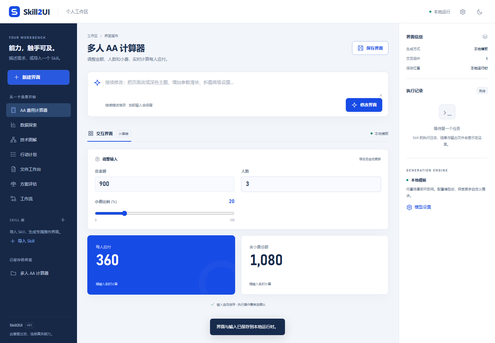

# Skill2UI

**Universal Generative UI Skill** — turn requests and Agent Skills into interactive tools connected to real execution.

[中文说明](README.zh-CN.md) · [Research](docs/research.md) · [Architecture](docs/architecture.md) · [Acceptance](docs/acceptance.md) · [Security](docs/security.md)

[GitHub repository](https://github.com/sharbvane/Skill2UI) · [v0.1.0 release](https://github.com/sharbvane/Skill2UI/releases/tag/v0.1.0) · [Python wheel](https://github.com/sharbvane/Skill2UI/releases/download/v0.1.0/skill2ui-0.1.0-py3-none-any.whl) · [SHA-256 checksums](https://github.com/sharbvane/Skill2UI/releases/download/v0.1.0/SHA256SUMS.txt)



An independent MIT project: standard Agent Skill, lightweight Python runtime, zero-build browser workbench, CLI/API, and optional MCP Apps adapter. **0.1.0 is the first runnable release**, not universal execution compatibility.

## What works

- Requests → validated UI. Seven local layouts: AA calculation, editable/filterable data charts, plans, diagrams, weighted comparisons, file previews and workflow panels. Configure an OpenAI-compatible model for custom planning.
- Skills → source-linked interfaces. Import installed/local directories, ZIP archives or GitHub Skill directories; inspect SKILL.md, scripts, references, assets and dependencies without executing them.
- Actions → real results. Recognized Python argparse and reviewed manifests map typed fields to argv. Command preview, one-use approval, jobs, logs, cancellation, timeout, restart recovery and verified output downloads invoke the original script/native tool.
- Edits → retained state. Stable IDs, chart/theme changes, add/remove sliders, collapsed settings, previews, save and restore.
- Agent integration. Portable Skill installation for Codex/Claude; official MCP/MCP Apps SDK adapter for generation, live arithmetic and static inspection. External execution uses the standalone workbench.

Agent Skills do not define a universal callable ABI. Unknown scripts, tool instructions and guide-only Skills show configuration needs or a guide; model suggestions cannot register commands. [Action adapters](docs/actions.md)

## Quick start

Python **3.11+**. Node is needed only for browser tests or rebuilding the shipped MCP bundle.

```sh
python -m venv .venv
# Windows
.venv\Scripts\python -m pip install -e ".[mcp]"
.venv\Scripts\skill2ui serve --port 7860
# macOS/Linux
.venv/bin/python -m pip install -e '.[mcp]'
.venv/bin/skill2ui serve --port 7860
```

Open [http://127.0.0.1:7860](http://127.0.0.1:7860). Select an example or describe a task. The service binds to loopback only. Windows convenience scripts install the tested lock:

```powershell
powershell -ExecutionPolicy Bypass -File scripts/setup.ps1
powershell -ExecutionPolicy Bypass -File scripts/start.ps1
```

Runtime data defaults to private `.skill2ui/`. Override with `--data-dir` or `SKILL2UI_DATA_DIR`. Keys and runtime data are excluded from Git.

## Real execution demos

Import `examples/csv-summary/`, select its `assets/example.csv`, keep output `result.json`, review the command and confirm. The original script returns a three-row summary and a downloadable result.

Import `examples/third-party/documents/`, select its original `fixtures/sample.pdf`, enable `json`, leave `render_check` off, and confirm. The unchanged MIT upstream script returns `status:ok`, one passed file and a downloadable captured JSON report. This proves **structural validation**, not PDF render/layout quality. [Source and license](examples/third-party/README.md)

## CLI, library and Agent installation

```sh
skill2ui generate "Create an AA bill calculator"
skill2ui inspect /path/to/skill --gui
skill2ui inspect https://github.com/owner/repo/tree/main/path/to/skill
skill2ui install-skill --host codex
skill2ui install-skill --host claude
skill2ui mcp --data-dir /private/runtime-data
```

Installation refuses to overwrite existing Skills. Other hosts can copy `skill2ui/agent/skill2ui/`. CLI generation writes a wrapper with `document`; pass the raw document to `generate --current ui.json` for edits.

Python APIs: `Generator`, `Inspector`, `JobManager`, `create_app`. [HTTP/Schema contract](docs/contract.md) · [Host adapters](docs/mcp.md)

## Models and privacy

Configure workbench settings or `SKILL2UI_BASE_URL`, `SKILL2UI_MODEL`, `SKILL2UI_API_KEY`. The runtime calls `/chat/completions`, tries JSON mode, validates output, retries invalid UI once and visibly falls back to local templates. HTTP endpoints are allowed only for local models. Workbench settings/keys stay in server memory.

Providers receive the request, current UI and non-credential state. Recognized credential fields are excluded from saved state and model edits; do not place secrets in free-form prompts/data. SSE progressively sends components **after whole-document validation**, not provider token streaming. Unfamiliar offline requests produce a configuration guide.

## Tests and development

```sh
python -m unittest discover -s tests -v
node skill2ui/web/selfcheck.mjs
npm ci
npx playwright install chromium  # if Chromium is not already installed
npm run test:browser
node tests/mcp-browser.mjs
npm run build:mcp
```

Use the project venv for Python. Browser tests start an isolated server, exercise A–E and write screenshots/report to `tests/artifacts/`. `SKILL2UI_PYTHON` and `SKILL2UI_TEST_PORT` override interpreter/port. The MCP browser test uses an official host bridge and real stdio server. [Actual outcomes and limits](docs/acceptance.md)

Six direct Python runtime dependencies; optional MCP versions in `requirements.lock`; development versions in `package-lock.json`. Browser code uses DOM/SVG with no frontend framework, chart library or external fonts. [Reuse/licenses](docs/third-party.md)

## Limits and next steps

Approved code runs with the current OS account: **this is not an OS sandbox**. Windows Job Objects bound process lifetime, not disk/network access. Use a container/VM for untrusted source. No arbitrary extension code is accepted.

Automatic execution discovery covers literal Python argparse; other interfaces need explicit configuration. Multi-file `nargs='+'` maps one selected file. Charts draw up to 120 rows; the table retains all rows. Uploaded blobs need reselection after reload. Embedded MCP UI is a subset of the standalone renderer. Actual production host embedding, paid model access and Linux/macOS execution remain unverified.

Next: OS isolation, explicit Agent/tool connectors, provider streaming, multi-file fields and A2UI/AG-UI interoperability tested against their protocols. These are future work.

## License

Own code: [MIT](LICENSE). Original examples and bundled SDK code retain their own licenses/notices. Research-only projects were not vendored. [Reuse ledger](docs/third-party.md)
