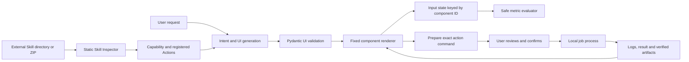

# Skill2UI architecture

Version 0.1 uses a Python service and a fixed browser renderer. The same validated UI document is used by the browser, CLI, Agent Skill, and optional MCP Apps resource. The API shapes are defined in [contract.md](contract.md); research and upstream distinctions are recorded in [research.md](research.md).

## The complete path

Generation never supplies an executor. A generated action component refers to an inspected action ID. Execution is resolved independently by the registered Capability and approved command. This is the core boundary that prevents a model from generating a command and granting itself permission to run it.

## Modules and data

| Module | Responsibility | Stable output |
|---|---|---|
| `generation.py` | Offline task selection and configurable OpenAI-compatible generation; follow-up changes | `UIDocument` plus explicit local/model mode |
| `schema.py` | Component allowlist, bounded document validation, arithmetic evaluation | Valid UI document and metrics |
| `inspector.py` | Local/GitHub/ZIP import, SKILL frontmatter/resources, supported CLI and manifest inspection | Capability with source version/hash, action status and parameters |
| `jobs.py` | Prepare command, explicit approval, async process lifecycle, logging and artifacts | Approval record and Job |
| `api.py` | Loopback same-origin API, session token, uploads, saved documents, static files | JSON responses and SSE component/document events |
| `web/` | Accessible controls, charts/tables, diagram/timeline, file/media, job progress/logs | User state and action requests |
| `cli.py` / packaged `agent/skill2ui/` | Standard CLI and Agent Skills invocation | Same runtime contracts |
| MCP adapter and bundled App resource | MCP tools, `ui://` resource, official App bridge | UI document/result through MCP structured content |

Three models remain distinct:

- **UI document** describes components, task kind, data, theme and action references. Component IDs link state to UI; a document is never a source file or program.
- **Capability** records a Skill's source, instructions/resources and inspected Actions. Missing dependencies, configuration needs and guide-only behavior remain visible.
- **Job** records one execution's exact command, real status, logs, result, artifacts and timestamps. A successful-looking UI cannot override a failed process.

The data directory holds imported capabilities, saved document/state pairs, uploaded inputs and job records/output. Generated artifacts are served only after the job manager verifies the requested artifact path. Runtime restart recovery records interrupted processes rather than claiming they continued.

## Generation and dynamic state

The local generator supports common calculation, data comparison, explanation, planning, file, evaluation and workflow shapes. It is a deterministic fallback and is labelled as local generation. It does not promise arbitrary semantic understanding. Optional model configuration accepts a user-provided OpenAI-compatible Base URL, model, key and timeout; model responses must pass the same validation as local results.

The component catalog is finite. Text, numeric input, slider, select, file, textarea, metric, table, chart, timeline, diagram, log, progress, media, action and group map to code maintained by the project. Unknown types and extra schema fields are rejected. Content is rendered as text, not as HTML supplied by the model or imported Skill.

Metrics use a server-side arithmetic interpreter restricted to supported numeric operations and input identifiers. No Python `eval`, browser `eval` or model-provided JavaScript is involved. Invalid expressions and bad numeric inputs surface as validation/evaluation errors.

Follow-up generation receives the current document and input state. Stable component IDs allow the renderer to preserve user values when a theme, layout or display component changes. Persisting a document includes its state. Removing a control intentionally removes its presentation; callers should not infer that a removed control remains an authorized action.

The SSE generation route emits status, components and a final document. In this version the service validates a complete generated document before emitting its components. This provides progressive delivery, not live provider-token rendering. The final validated document is authoritative.

## Skill inspection and action binding

1. Resolve a selected Skill root and read `SKILL.md` as data. Validate required frontmatter and collect bounded resources. Preserve the original source association and content hash.
2. Examine supported Python CLI declarations statically. Literal argparse fields become typed input controls; dependencies and interpreter readiness determine action status. Importing a Skill does not import its Python module or execute `--help`.
3. Read supported local action manifests as declarations. Validate interpreter/script path and parameters; unsupported or dynamic interfaces need configuration. A manifest does not silently make its command trusted.
4. Keep instruction-only skills as guide surfaces. Present steps and source resources without pretending to have a runnable implementation.
5. Before a runnable action starts, validate user parameters, resolve the original inspected script and show the actual argv list, permissions and local-process warning.
6. Only an explicitly confirmed approval starts a Job. Process exit, JSON/text output, errors and verified files determine the result shown to the user.

The import modes share the same Inspector. Archives require safe extraction and reject escapes/symlinks/oversized input; GitHub imports preserve source identity and resolved commit information. A repository without a usable `SKILL.md` is an import error, not a guessed executable skill.

Agent Skills is an instructions format, not a universal callable ABI. Python argparse is the supported automatic execution subset; tools requiring credentials, deferred host APIs, dynamic parsers or other languages need explicit registered integration. This is a compatibility boundary, not proof that every imported Skill can run unchanged.

## Browser and process security

The server listens on loopback. API middleware checks hosts/origins and rejects cross-site fetches; requests use a runtime session token. CSP blocks foreign code, frames and object execution in the independent runtime. API validation avoids echoing supplied credentials in error payloads. Keys configured through the UI stay in process memory; environment configuration remains possible.

Uploads are bounded and stored under managed paths. Component values do not become arbitrary shell text: jobs use argv with shell execution disabled. Input validation, command preview, source identity checks, interpreter checks, timeout and cancellation are applied at the bridge. Logs and job records should contain actual task output rather than synthetic progress claims.

**The job runner is a local subprocess, not an OS sandbox.** The script runs with the user's process permissions and may read files, write files or contact services that its own code chooses. A working directory and trimmed environment do not prevent those effects. Only reviewed or trusted Skills should be approved. Untrusted execution requires a future OS/container isolation backend with its own tests.

The distinction matters twice: schema constraints protect the UI from generated code; MCP iframe restrictions protect a host from browser UI. Neither provides server-side process confinement.

## Host adapters

The packaged `SKILL.md` is the portable entrypoint. Codex and Claude Code can install it and invoke the CLI or loopback runtime as standard Agent Skills clients. This does not require a custom framework plugin.

The MCP adapter exposes tools and an HTML resource. A tool uses `_meta.ui.resourceUri`; the resource has MIME `text/html;profile=mcp-app`. Its fixed renderer and official `@modelcontextprotocol/ext-apps` App SDK are bundled together. Handler registration precedes `App.connect()`, initial results arrive through `ontoolresult`, and user controls invoke `callServerTool()` through the host. The resource makes no request to an iframe-hosted localhost application and requires no external asset domains.

The same schema, Inspector and evaluator serve requests through either transport. This release's MCP adapter exposes only generation, calculation and static inspection. File uploads, approvals and JobManager execution use the standalone browser runtime. A future execution adapter must enforce the same registered action and prepared-command approval rules; host tool annotations alone do not grant execution permission.

MCP Apps support must be negotiated with the host. Hosts that only implement core MCP can consume textual/structured tool results; they cannot be assumed to display the resource. Real Codex/Claude host embedding needs a host-specific check in addition to MCP client protocol tests. The independent browser is the predictable fallback.

## Dependency and reuse decisions

Python 3.11+, FastAPI/Pydantic/Uvicorn provide the service and boundary validation; PyYAML parses Skills, python-multipart receives uploads and httpx calls model providers. The optional Python MCP SDK adds the server transport. The browser renderer uses ES modules and platform DOM/SVG features, avoiding a frontend framework or chart runtime for the current component set.

Only the optional MCP App build adds Node, esbuild and the official MCP Apps SDK. Runtime distribution includes the generated resource and relevant third-party licenses. Development uses Playwright for real browser acceptance; users do not need Playwright to run the package.

The MIT documents Skill is a separate unchanged example, not a copied internal execution implementation. Its original script is invoked after inspection and approval. Research-only projects are referenced, not bundled. Exact upstream revisions, usage and licenses are listed in [third-party.md](third-party.md).

## Verification targets

Unit tests cover schemas/arithmetic, import trust boundaries, static CLI mapping, action parameter validation, approval and job outcomes. Browser acceptance exercises AA calculation, state changes and recovery, data filters/display changes, real third-party execution, guide/tool/script classification, keyboard/mobile behavior and visible error handling. MCP client tests verify resource metadata and round-trip calls; mock-host App tests verify bridge behavior.

These tests have distinct evidence. A simulated provider proves response handling, not access to a paid model. A protocol client proves transport compatibility, not a production host's embedded rendering. Structural document checks prove container sanity, not visual layout. Release acceptance records should state each separately.
